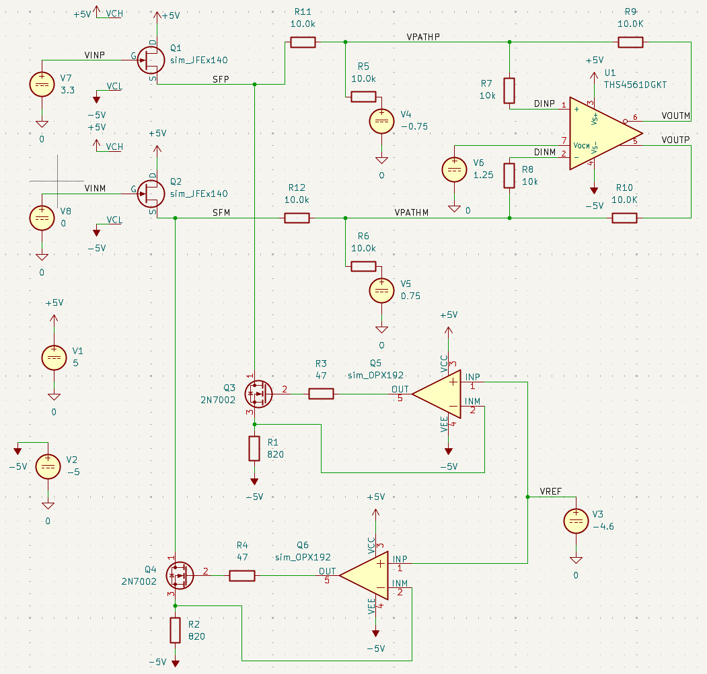

# FEE-D: Differential-Amplifier-Based Front-End Electronics

## 1. Overview

FEE-D is a front-end electronics design for CMOS image detectors, providing 16 channels of analog signal acquisition together with detector power supplies, bias voltages, clock driving, and monitoring functions.

The system consists of a Fan-Out Board located close to the detector and a Front-End Board connected through cables. The Fan-Out Board employs JFET source followers to buffer the detector output signals. The associated bias-current circuits are located on the Front-End Board.

The Front-End Board contains fully differential amplifiers, differential-input analog-to-digital converters (ADCs), DAC-based voltage generators, clock buffers, and monitoring circuits.

The complete Front-End Board schematic is available in [FEED.pdf](/assets/detector-front-end/fee-d/FEED.pdf).

## 2. Analog Signal Processing

The Front-End Board contains 16 identical analog acquisition channels. Each channel consists of JFET source-follower buffers, a fully differential amplifier, and a 16-bit differential-input ADC.

### 2.1 JFET Source Followers

The Fan-Out Board employs JFE2140 JFETs configured as source followers. These buffers provide high input impedance and drive the cables connecting the Fan-Out Board to the Front-End Board.

The source followers are operated with bias currents supplied by constant-current circuits on the Front-End Board.

The source-follower output voltages differ from the detector output voltages by the gate-to-source voltage of the JFETs. This voltage difference depends on the device characteristics and operating current.

### 2.2 Fully Differential Amplifier

The two buffered signals are processed by a THS4561 fully differential amplifier.

The amplifier converts the input voltage difference into a differential output suitable for the ADC. Its gain is determined by the input and feedback resistor networks.

Offset voltages are introduced through the input resistor networks to adjust the differential output range. The output common-mode voltage is controlled independently through the amplifier's VOCM input.

This arrangement allows the differential signal and its common-mode voltage to be adjusted separately.

### 2.3 Analog-to-Digital Conversion

Each channel uses an LTC2378-16, a 16-bit differential-input ADC.

The amplifier outputs are connected to the ADC through a symmetrical RC network. This network provides filtering and helps drive the ADC input during sampling.

The ADCs operate with common conversion timing, and their serial output data are transferred to the external digital acquisition electronics.

## 3. Power and Bias Generation

The Front-End Board provides the power supplies and bias voltages required for detector operation.

A DAC7568 eight-channel digital-to-analog converter generates adjustable bias voltages. Operational-amplifier buffers provide the required output drive capability.

The board also includes constant-current circuits for the JFET source followers. These circuits establish the operating currents of the JFETs.

Low-noise voltage regulators and local decoupling circuits are used to supply the analog signal processing circuits.

## 4. Clock and Control Interface

Clock signals generated by the external digital control electronics are received by the Front-End Board and delivered to the detector through clock buffers.

The clock buffer circuit uses a TC74VHC541 octal buffer with series resistors at its inputs and outputs.

The board also receives control signals for the DACs, ADC conversion, and monitoring circuits. Digitized detector data are transmitted to the external data acquisition electronics through serial interfaces.

## 5. Monitoring

The Front-End Board includes circuits for monitoring detector bias voltages.

Each monitored voltage is scaled and buffered before being supplied to a dedicated multichannel ADC.

The monitoring functions allow the host system to verify the electrical operating conditions of the detector.

## 6. Simulation

The analog signal processing circuit has been evaluated using ngspice.

The simulation model includes two JFET source followers, their bias-current circuits, and the THS4561 fully differential amplifier. The model uses specified input and offset voltages to examine the DC transfer characteristics.

*Figure 1. ngspice simulation circuit for the JFET source followers and fully differential amplifier. Click the image to view it at full size.*

The following table shows representative DC simulation results. VINM is fixed at 0 V, while VINP is varied.

| VINP (V) | VINM (V) | SFP (V) | SFM (V) | VOUTP (V) | VOUTM (V) | Differential output (V) |
|---:|---:|---:|---:|---:|---:|---:|
| 0.0 | 0.0 | 0.7884 | 0.7884 | 0.5005 | 2.0000 | -1.4995 |
| 1.5 | 0.0 | 2.2644 | 0.7931 | 1.2360 | 1.2645 | -0.0284 |
| 3.3 | 0.0 | 4.0377 | 0.7989 | 2.1196 | 0.3809 | +1.7388 |

The differential output is defined as

\[
V_{\mathrm{diff}}=V_{\mathrm{OUTP}}-V_{\mathrm{OUTM}}.
\]

The output common-mode voltage is

\[
V_{\mathrm{mean}}=
\frac{V_{\mathrm{OUTP}}+V_{\mathrm{OUTM}}}{2}.
\]

In these simulations, the output common-mode voltage remains approximately 1.25 V, as specified by the VOCM input of the THS4561.

The JFET source followers track changes in the input voltages while introducing a gate-to-source voltage shift. The fully differential amplifier produces a differential output that varies with the input signal.

The nonzero differential output at VINP = VINM = 0 V results from the offset voltages applied in the simulation circuit.

These results demonstrate the DC behavior of the simulated circuit under the specified conditions. They do not establish the noise performance, frequency response, or measured performance of the hardware.

## 7. Design Files

The following design materials are provided:

- **[Front-End Board schematic (PDF)](/assets/detector-front-end/fee-d/FEED.pdf)** — Complete circuit schematic, including analog acquisition channels, detector bias generation, clock buffers, and monitoring circuits.
- **[Analog circuit simulation](/assets/detector-front-end/fee-d/ampmodel.png)** — ngspice simulation circuit for the JFET source followers and fully differential amplifier.

The Fan-Out Board is described at the functional level in the [overall FEE documentation](/projects/detector/front-end/). Its detailed schematic and PCB design files are not included in this repository.
