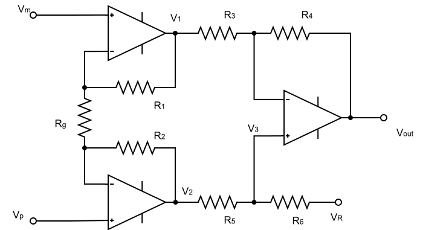
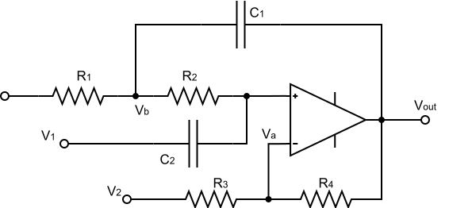

# Analog Signal Processing Design

## 1. Introduction

The analog signal processing circuits of FEE-I are designed to acquire pixel signals from CMOS
image detectors and convert them into digital data.

The detector output is a step-like waveform whose voltage changes as successive pixels are selected.
The analog signal processing chain must provide appropriate amplification, offset adjustment, and bandwidth limitation while allowing the signal to settle sufficiently before each A/D conversion.

The signal processing chain consists of three stages:

1. An instrumentation amplifier that converts the differential input signal into
a single-ended signal.
2. An active low-pass filter that limits the signal bandwidth and adjusts the DC offset.
3. An analog-to-digital converter (ADC) that digitizes the conditioned signal.

The following sections describe the design principles and the relationships between circuit parameters.

## 2. Instrumentation Amplifier

### 2.1 Circuit Configuration

The instrumentation amplifier consists of three operational amplifiers, as shown in Figure 1.

*Figure 1. Three-operational-amplifier instrumentation amplifier.*

The first two operational amplifiers provide high input impedance and differential gain.
The third operational amplifier converts the differential signal into a single-ended output.

The two input voltages are denoted by $V_p$ and $V_m$, and the output voltage by $V_{\mathrm{out}}$.

### 2.2 Common-Mode Rejection

For the circuit to reject common-mode input signals, the resistor network of the differential output stage must satisfy

$$
\boxed{R_3 R_6=R_4 R_5}.
$$

In practice, the common-mode rejection ratio (CMRR) depends on the matching accuracy of these resistor ratios. Precision resistors are therefore important, particularly in applications where the detector and the front-end electronics may have different ground potentials.

### 2.3 Differential Gain

When the common-mode rejection condition is satisfied, the differential gain is determined by the resistor network.

If all resistors except $R_g$ have the same resistance $R_A$,

$$
R_1=R_2=R_3=R_4=R_5=R_6=R_A,
$$

the gain becomes

$$
\boxed{G_A=1+\frac{2R_A}{R_g}}.
$$

Thus, the gain can be adjusted by changing $R_g$ while keeping the other resistors equal.

When $R_g$ is omitted, corresponding to $R_g\rightarrow\infty$, the gain becomes unity.

### 2.4 Offset Voltage

The instrumentation amplifier also allows an offset voltage to be introduced through the reference input $V_R$.

When the resistor ratios satisfy the common-mode rejection condition, the output can be expressed as

$$
V_{\mathrm{out}}=G_A(V_p-V_m)+V_R.
$$

An appropriate reference voltage can therefore shift the amplified signal to the required output range.

In FEE-I, however, the reference input of the instrumentation amplifier is connected to ground. The offset adjustment is instead performed in the following analog filter stage.

This separates differential amplification from offset adjustment and allows the ADC input range to be matched independently of the instrumentation amplifier gain.

## 3. Analog Low-Pass Filter

### 3.1 Filter Configuration

The output of the instrumentation amplifier is processed by a second-order active low-pass filter based on a voltage-controlled voltage source (VCVS) configuration.

The circuit is shown in Figure 2.

*Figure 2. Second-order VCVS low-pass filter.*

The filter serves two purposes:

- It limits the analog bandwidth to reduce high-frequency noise.
- It provides the required step response so that the signal settles sufficiently before A/D conversion.

The circuit also provides gain and offset adjustment.

### 3.2 Transfer Function

For the frequency-response analysis, the offset inputs $V_1$ and $V_2$ in Figure 2 are set to ground.

The transfer function of the second-order filter can be written as

$$
T(f)= \frac{A}{ 1-(f/f_0)^2-iQ^{-1}(f/f_0) },
$$

where

- $A$ is the DC gain,
- $f_0$ is the characteristic frequency,
- $Q$ is the quality factor controlling the filter response.

For the circuit in Figure 2, these parameters are

$$
\boxed{A=\frac{R_3+R_4}{R_3}}
$$

$$
\boxed{ f_0=\frac{1}{2\pi\sqrt{C_1C_2R_1R_2}} }
$$

and

$$
\boxed{ Q= \frac{\sqrt{C_1C_2R_1R_2}} {C_2R_2-C_1R_1R_4/R_3+C_2R_1} }.
$$

These equations allow the filter characteristics to be determined directly from the circuit components.

### 3.3 Simplified Component Selection

The design can be simplified by choosing equal resistors and capacitors in the frequency-selective network:

$$
R_1=R_2=R_F, \qquad C_1=C_2=C_F.
$$

The characteristic frequency then becomes

$$
\boxed{f_0=\frac{1}{2\pi R_FC_F}},
$$

and the quality factor becomes

$$
\boxed{Q=\frac{1}{2-R_4/R_3}}.
$$

The DC gain remains

$$
A=1+\frac{R_4}{R_3}.
$$

Consequently, the resistor ratio $R_4/R_3$ determines both the gain and the quality factor, while $R_FC_F$ determines the characteristic frequency.

### 3.4 Bessel Filter Response

The detector output changes approximately as a step function when successive pixels are read out.

For such signals, excessive overshoot and ringing can introduce errors into the measured pixel values.
The transient response is therefore an important consideration in selecting the filter characteristics.

A second-order Bessel response is chosen to reduce waveform distortion and provide a well-behaved step response.

For a second-order Bessel filter,

$$
\boxed{Q=\frac{1}{\sqrt{3}}}.
$$

Combining this with the simplified expression for $Q$,

$$
2-\frac{R_4}{R_3}=\sqrt{3},
$$

which gives

$$
\boxed{\frac{R_4}{R_3}=2-\sqrt{3}}.
$$

The corresponding DC gain is

$$
\boxed{A=3-\sqrt{3}\simeq1.268}.
$$

The actual resistor values can be selected from standard component series while maintaining this ratio as closely as practical.

### 3.5 Bandwidth and Settling Time

Bandwidth limitation reduces noise, but it also increases the time required for the signal to settle after a step change.

For a pixel readout system, the settling time must be short enough that the residual error at the ADC sampling instant is smaller than the required measurement accuracy.

For the second-order filter, the exponential decay of the step-response envelope is characterized by

$$
\tau=\frac{Q}{\pi f_0}.
$$

The time required for this envelope to decrease by a factor of $2^{-N}$ is

$$
\boxed{ t_s(N)=N\ln(2)\frac{Q}{\pi f_0} }.
$$

For a 16-bit settling criterion,

$$
t_s(16)=16\ln(2)\frac{Q}{\pi f_0}.
$$

This expression provides a useful design criterion for selecting the filter bandwidth.

The FEE-I analog signal chain was designed for a pixel rate of approximately 200 kHz,
corresponding to a 5 µs pixel period.
The filter bandwidth was selected so that the signal could settle to the required accuracy within the time available before A/D conversion.

Increasing the filter bandwidth reduces settling time but also allows more high-frequency noise to pass. The filter design must therefore balance noise reduction against settling accuracy.

## 4. ADC: Signal-to-Noise Ratio and Effective Number of Bits

### 4.1 Signal-to-Noise Ratio

The signal-to-noise ratio (SNR) of an ADC is defined as the ratio of signal power to noise power.

Expressed in decibels,

$$
\boxed{ \mathrm{SNR} = 20\log_{10} \left( \frac{V_{\mathrm{signal,rms}}} {V_{\mathrm{noise,rms}}} \right) }.
$$

ADC datasheets commonly specify SNR using a sinusoidal input signal.
The digitized waveform is analyzed in the frequency domain,
and the noise power is evaluated excluding the input signal component and, for
SNR, harmonic distortion components.

### 4.2 Quantization Noise

An ideal $N$-bit ADC divides its input voltage range into $2^N$ discrete levels.

If the voltage corresponding to one least significant bit is $V_{\mathrm{LSB}}$,
the quantization error is assumed to be uniformly distributed over

$$
-\frac{V_{\mathrm{LSB}}}{2} \leq e \leq \frac{V_{\mathrm{LSB}}}{2}.
$$

The mean-square quantization error is

$$
V_{\mathrm{noise,rms}}^2 = \frac{1}{V_{\mathrm{LSB}}} \int_{-V_{\mathrm{LSB}}/2}^{V_{\mathrm{LSB}}/2} e^2\,de = \frac{V_{\mathrm{LSB}}^2}{12}.
$$

Therefore,

$$
\boxed{ V_{\mathrm{noise,rms}} = \frac{V_{\mathrm{LSB}}}{\sqrt{12}} }.
$$

### 4.3 Ideal ADC SNR

For a full-scale sinusoidal input, the RMS signal voltage is approximately

$$
V_{\mathrm{signal,rms}} = \frac{2^N V_{\mathrm{LSB}}}{2\sqrt{2}}.
$$

Combining this with the quantization noise gives

$$
\mathrm{SNR} = 20\log_{10} \left( \frac{2^N\sqrt{12}}{2\sqrt{2}} \right).
$$

Thus, the theoretical SNR of an ideal $N$-bit ADC is

$$
\boxed{ \mathrm{SNR}=6.02N+1.76\ \mathrm{dB} }.
$$

For example, an ideal 16-bit ADC has an SNR of approximately 98.1 dB.

Real ADCs exhibit additional noise,
so their measured SNR is generally lower than this theoretical limit.

### 4.4 Effective Number of Bits

The effective number of bits (ENOB) expresses the measured ADC performance as an equivalent number of ideal quantization bits.

Using the ideal SNR relationship,

$$
\boxed{ \mathrm{ENOB} = \frac{\mathrm{SNR}-1.76}{6.02} }.
$$

An ADC with a nominal resolution of 16 bits does not necessarily provide 16 bits of effective resolution.

For example, an SNR of 92 dB corresponds to

$$
\mathrm{ENOB} = \frac{92-1.76}{6.02} \simeq15.0.
$$

When evaluating an ADC for precision detector readout, both its nominal resolution and its noise performance must therefore be considered.

The ENOB definition is also commonly based on SINAD (signal-to-noise-and-distortion ratio), which includes harmonic distortion. The SNR-based expression above represents an equivalent resolution based on noise alone.

## 5. Design Considerations

The analog signal processing chain must be designed as a whole rather than by selecting
the instrumentation amplifier, filter, and ADC independently.

The main design considerations are:

1. **Input signal range:** Determine the expected detector output voltage range and the required differential input configuration.
2. **Gain and offset:** Select the instrumentation amplifier gain and filter offset so that the detector signal uses an appropriate portion of the ADC input range.
3. **Common-mode rejection:** Maintain accurate resistor-ratio matching to suppress common-mode signals.
4. **Noise and bandwidth:** Select the filter characteristics to limit noise while preserving the required transient response.
5. **Settling accuracy:** Verify that the analog output settles sufficiently before the ADC sampling instant.
6. **ADC performance:** Select an ADC with adequate resolution, SNR, and sampling rate for the required measurement accuracy.

For FEE-I, the analog filter uses a second-order Bessel response, and the instrumentation amplifier and filter parameters are selected to satisfy the signal range, noise, and settling requirements of the detector readout system.

The complete circuit implementation is provided in the [FEE-I schematic](/assets/detector-front-end/fee-i/FEEI.pdf).
