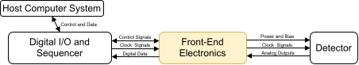
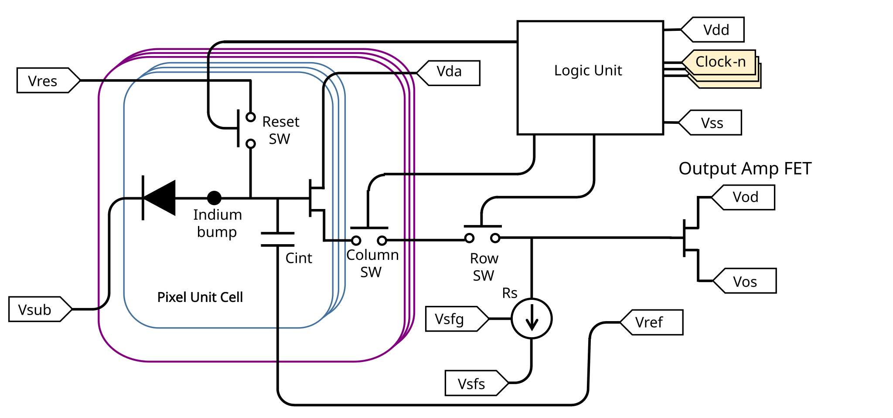
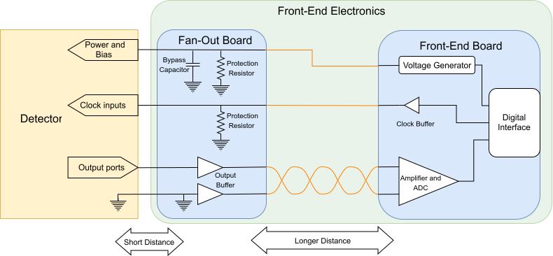

# Detector Front-End Electronics

## 1. Introduction

This repository provides hardware designs and technical documentation for front-end electronics
used to operate and read out CMOS-based image detectors, particularly infrared detectors.

A typical detector system consists of a host computer, digital control and
data acquisition electronics, front-end electronics (FEE), and a detector.
The host computer controls the system and receives the acquired image data.
The digital electronics generate the clock sequences required for detector operation and
acquire digitized image data from the FEE.
The FEE provides the detector with power supplies, bias voltages, and clock signals,
and converts its analog outputs into digital data.

*Figure 1. Overall configuration of a CMOS detector readout and control system.*

This repository focuses on the analog and mixed-signal electronics between the detector and
the digital control system.
The digital control and data acquisition electronics are described separately in
the [Data Acquisition System](https://github.com/indepex/data-acquisition-system) repository.

Two alternative FEE designs are presented. They are intended for the same detector
interface but employ different approaches to analog signal buffering and amplification.

## 2. CMOS Readout Integrated Circuit (ROIC)

CMOS readout integrated circuits (ROICs) are widely used in image detectors operating at
visible and infrared wavelengths.

In hybrid infrared detectors, a photosensitive semiconductor array, such as an InGaAs or
HgCdTe array, is electrically connected to a silicon CMOS ROIC, typically through indium bumps.
The ROIC provides the circuitry required to integrate, select, and read out the signals
generated by individual detector pixels.

The simplified ROIC architecture considered here consists of an array of pixel unit cells,
row and column selection circuits, and analog output circuitry.

*Figure 2. Simplified architecture of a CMOS ROIC and its pixel readout circuitry.*

Each pixel unit cell integrates the detector photocurrent on a capacitance during the
exposure period.
The accumulated signal is then read out through the pixel selection circuitry.
Reset operations and the readout sequence are controlled by externally supplied clock signals.

The ROIC includes an output-stage field-effect transistor (FET) configured as a source follower.
An external load or bias-current circuit is required to establish its operating point.

The detector therefore requires several electrical interfaces:

- **Power supplies and bias voltages** for the pixel array and readout circuitry.
- **Clock and control signals** for reset, integration, pixel selection, and readout.
- **Analog output signals** carrying the detector measurements.

The exact ROIC architecture, signal definitions, and timing requirements depend on
the detector being used. The diagram illustrates the architecture relevant to
the electronics described in this repository rather than a universal CMOS detector design.

## 3. Detector Interface and Fan-Out Board

The front-end electronics consist of two boards: a Fan-Out Board and a Front-End Board.
The Fan-Out Board is located immediately adjacent to the detector,
while the Front-End Board can be placed at some distance from it.
The two boards are connected by cables.

The Fan-Out Board provides electrical connections to the detector and incorporates
several components:

- **Bypass capacitors** for local decoupling of power and bias lines.
- **Protection resistors** to prevent floating potentials and provide a discharge path for
accumulated static charge.
- **Output buffers** to isolate the detector outputs from the relatively long cables connecting
the Fan-Out Board to the Front-End Board.

The protection resistors are high-value resistors (10 MΩ) connected between the relevant
signal lines and ground.
They prevent the lines from floating when cables are disconnected and allow accumulated
static charge to dissipate. They are not intended to replace dedicated protection devices
against fast electrostatic discharge (ESD) events.

The output buffer implementation differs between the two FEE designs.
One uses operational-amplifier voltage followers, while the other uses FET source followers
with bias-current circuitry located on the Front-End Board.

The Fan-Out Board is described here at the functional level; its detailed circuit and PCB
design files are not included in this repository.

## 4. Front-End Electronics (FEE)

The term **Front-End Electronics (FEE)** refers collectively to the Fan-Out Board and
the Front-End Board.

*Figure 3. Conceptual architecture of the front-end electronics, consisting of a Fan-Out Board and a Front-End Board.*

The Front-End Board performs four principal functions:

- **Power and bias generation:** Supplies the voltages required for detector operation.
- **Clock buffering:** Receives clock signals from the digital control system and provides
the electrical drive required by the detector.
- **Analog signal conditioning and A/D conversion:** Amplifies and filters the detector
output signals and converts them into digital data.
- **Digital interface:** Connects the Front-End Board to the external digital control and
data acquisition electronics.

Two alternative implementations of the FEE have been developed.

### 4.1 FEE-I: Instrumentation-Amplifier-Based Design

The first design employs operational-amplifier voltage followers on the Fan-Out Board
to buffer the detector output signals.

The Front-End Board uses instrumentation-amplifier circuitry for analog signal amplification,
followed by low-pass filtering and single-ended analog-to-digital conversion.

This design also incorporates circuitry for monitoring and protecting the detector
power supplies against excessive current.

Further details are provided in the [FEE-I documentation](/projects/detector/front-end/fee-i/).

### 4.2 FEE-D: Differential-Amplifier-Based Design

The second design employs FET source followers on the Fan-Out Board.
Their associated bias-current circuits are located on the Front-End Board.

The analog signal conditioning circuitry uses a fully differential amplifier,
followed by differential analog-to-digital conversion.

The analog front-end circuits have also been modeled and evaluated using ngspice.

Further details are provided in the [FEE-D documentation](/projects/detector/front-end/fee-d/).

Both designs provide the same basic detector interface functions,
but differ in their analog circuit architectures and implementation details.
